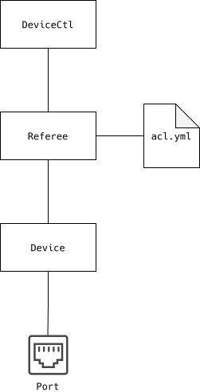
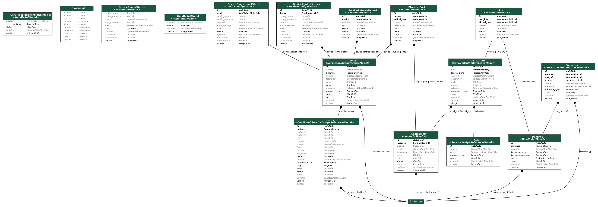
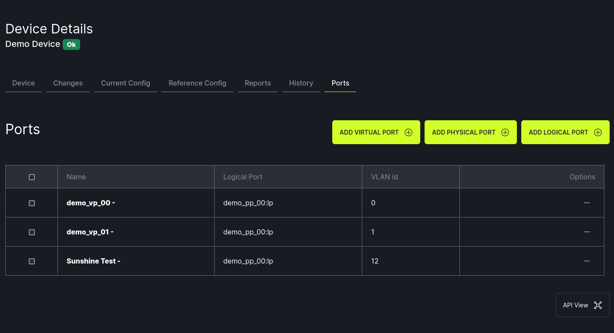
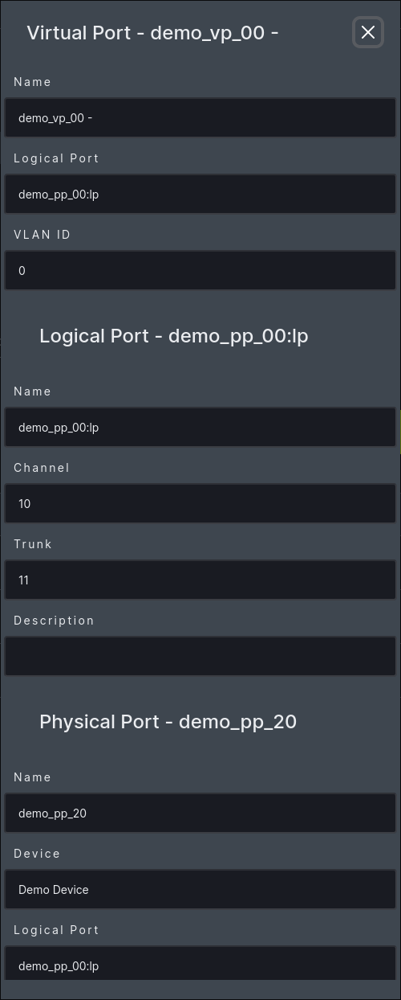

# ACL attached to Interface

- [Implementation Proposal](#implementation-proposal)
- [For Further Discussions](#for-further-discussions)
- [References](#references)

## Implementation Proposal



- [model](#model) src/devicectl/src/django_devicectl/models/devicectl.py
- api
  - [serializer](#rest-serializer) src/devicectl/src/django_devicectl/rest/serializers/devicectl.py
  - [view](#rest-view) src/devicectl/src/django_devicectl/rest/views/devicectl.py
- gui
  - [template](#gui-template) src/devicectl/src/django_devicectl/templates/devicectl/v2/tool/virtual_ports/list.html
  - [modal](#devicectl-ports-details) src/devicectl/src/django_devicectl/static/devicectl/v2/devicectl.js

### Model



`ACL` model identify by `name`

`VirtualPort` model with attached `ACL`

Make a migration to update the database because of the change in the model's structure.

```bash
[sergio@dev5 devicectl]$ docker exec -u root -it dev-custom-devicectl_web-1 sh

/srv/service # python main/manage.py makemigrations

/srv/service # python main/manage.py migrate
```

Insert test data.

```bash
/srv/service # python main/manage.py shell
```

```bash
>>> from django_devicectl.models import ACL
>>> acl = ACL()
>>> acl.name = "acl_demo_01"
>>> acl.save()
>>> acl
<ACL: ACL object (1)>

```

```bash

>>> ACL.objects.all().values()
<QuerySet [{'id': 1, 'created': datetime.datetime(2024, 7, 11, 21, 48, 28, 930429, tzinfo=datetime.timezone.utc), 'updated': datetime.datetime(2024, 7, 11, 21, 48, 28, 930480, tzinfo=datetime.timezone.utc), 'version': 0, 'status': 'ok', 'name': 'acl_demo_01'}]>
```

### Rest Serializer

`ACL` serializer

`VirtualPort` serializer with attached `ACL`


```bash
[sergio@dev5 devicectl]$ docker exec -u root -it dev-custom-devicectl_web-1 sh
/srv/service # python main/manage.py shell
```

Insert test data.

```bash
>>> from django_devicectl.models import ACL
>>> from django_devicectl.rest.serializers.devicectl import ACL as ACLSerializer
>>> acl = {"name": "acl_demo_02"}
>>> serializer = ACLSerializer(data=acl)
>>> serializer.is_valid()
True
>>> serializer.save()
<ACL: ACL object (2)>
>>> ACL.objects.all().values()
<QuerySet [{'id': 1, 'created': datetime.datetime(2024, 7, 11, 22, 21, 33, 257550, tzinfo=datetime.timezone.utc), 'updated': datetime.datetime(2024, 7, 11, 22, 21, 33, 257595, tzinfo=datetime.timezone.utc), 'version': 0, 'status': 'ok', 'name': 'acl_demo_01'}, {'id': 2, 'created': datetime.datetime(2024, 7, 11, 22, 24, 36, 546415, tzinfo=datetime.timezone.utc), 'updated': datetime.datetime(2024, 7, 11, 22, 24, 36, 546477, tzinfo=datetime.timezone.utc), 'version': 0, 'status': 'ok', 'name': 'acl_demo_02'}]>
```

### Rest View

`ACL` view list
`ACL` view detail

`VirtualPort` view with attached `ACLs`

### Rest Route

```
/api/virtual_port/{org_tag}/{virtual_port_id}/
```

```json
{
  "data": [
    {
      "name": "demo_vp_00",
      ...
      "acls": [
        {
          "name": "acl_00",
          ...
        }
        ...
      ],
      "id": 20,
      ...
    }
  ],
  "errors": {},
  "profiling": {
    "queries": 38
  }
}
```

```
/api/acl/{org_tag}/
/api/acl/{org_tag}/{acl_id}/
```

- [ ] New endpoints `/api/acl` are returning 403?

### GUI Template

How are ACLs going to be displayed?

#### DeviceCtl Ports List

New column in table?



#### DeviceCtl Ports Details

New section in modal?



`ModalVirtualPort`
## For Further Discussions
### deviceCtl django admin
src/django_devicectl/admin.py add acl model.
### Referee Integration

ACLs are stored in yaml files in Referee.

One file per device.

```
src/dev0/yaml/load/host/lab-9k/acl.yaml
```

With following content:

```
acl:
  - name: acltest1_v1
    rules:
      - permit ip any any
  - name: acltest2_v1
    rules:
      - permit ip any any

```

#### Sync Data With Referee

How to get ACL data from referee?

Reference object with `ServiceBridgeReferenceModel`?


### aclCtl Integration

## References

- https://app.clickup.com/t/14289126/FC-3187
