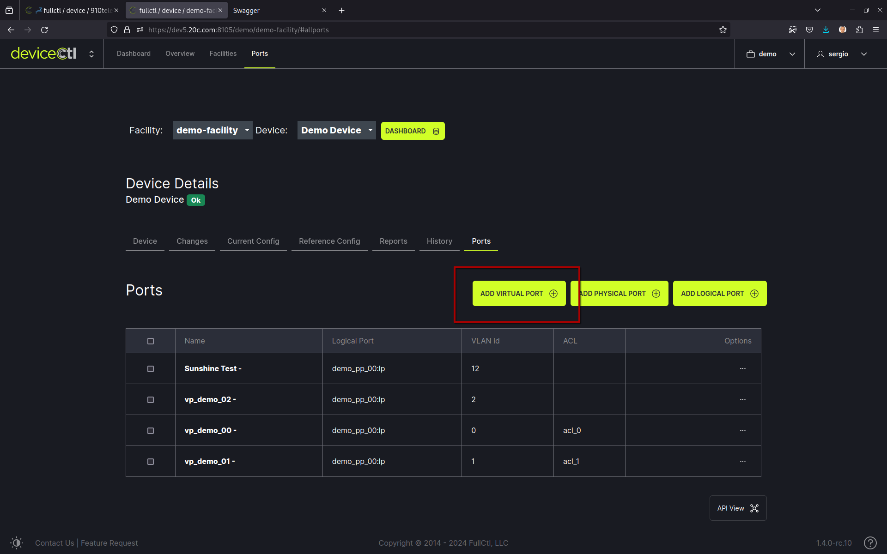
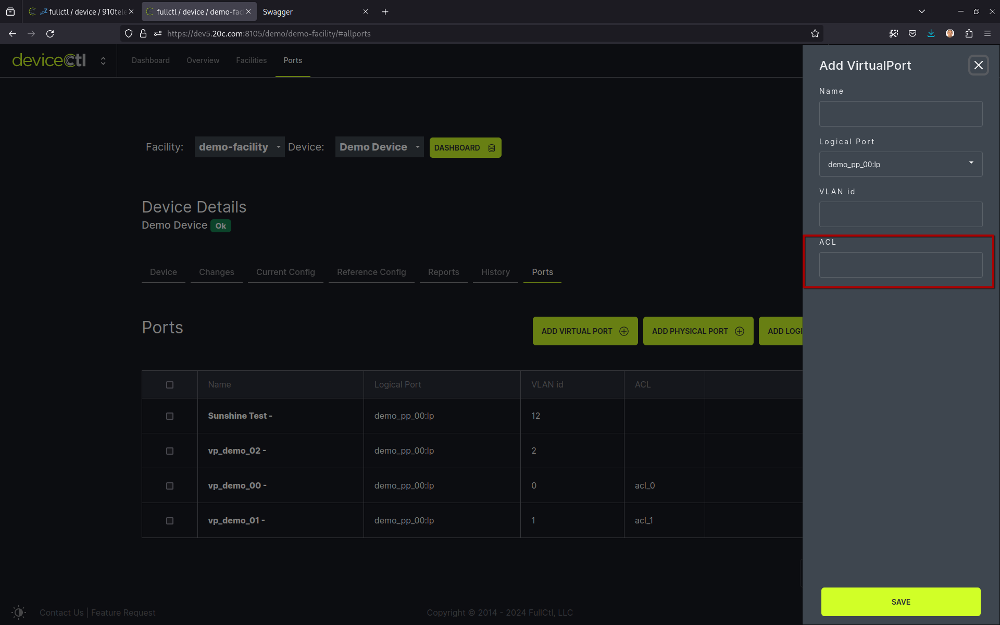
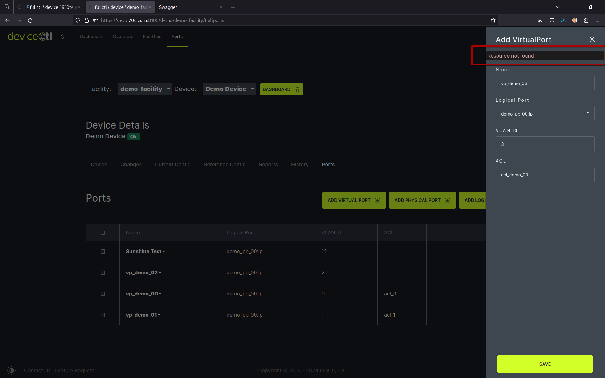
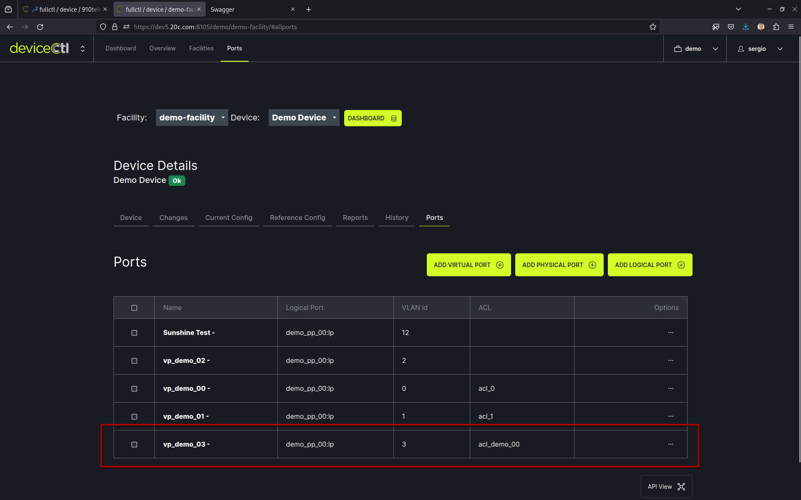
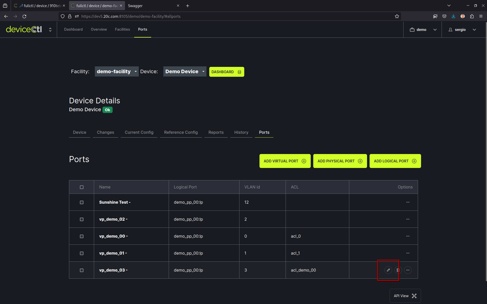
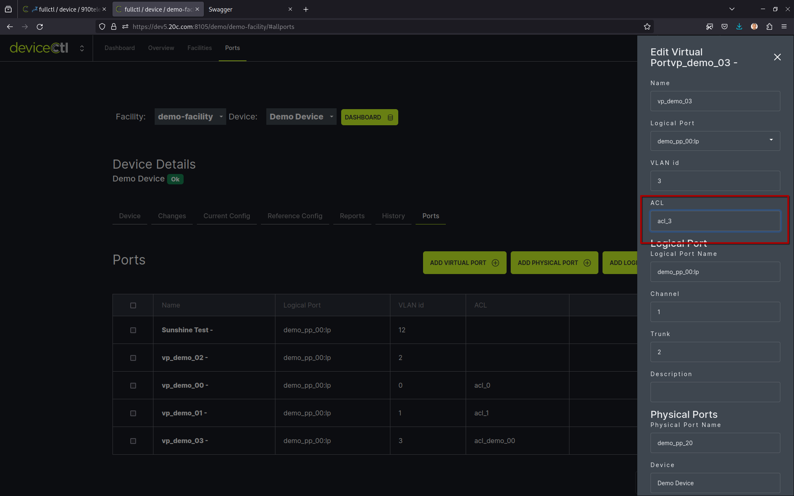
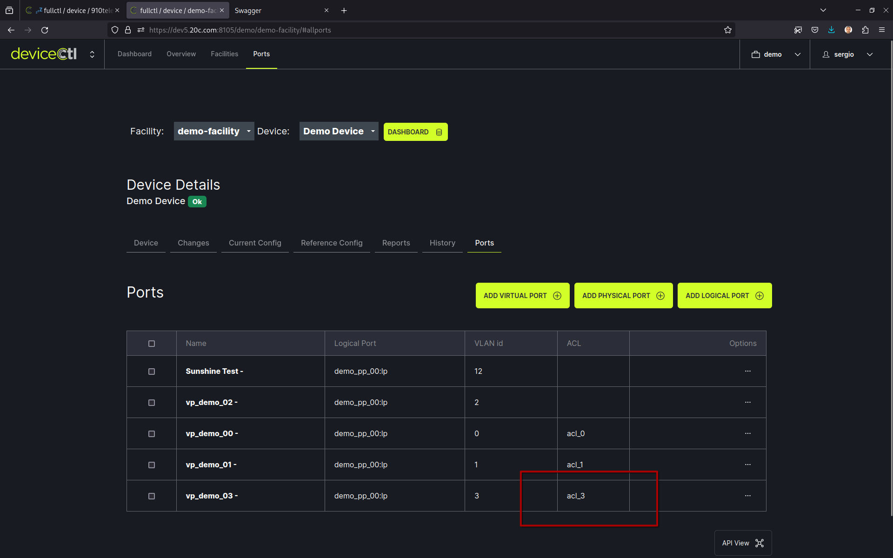
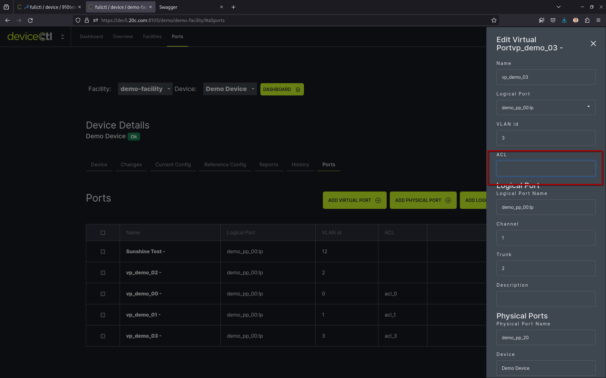

# ACL

[[_TOC_]]

## GUI

```
https://dev5.20c.com:8105/demo/
```

### Attach one ACL when creating a Virtual Port

ACL must exists to be attached to a Virtual Port. More info [Create an ACL](#create_an_acl)

Add a new Virtual Port.



Introduce the ACL name.



If ACL does not exist there will be an error.



If ACL exists, virtual port is created and ACL attached.




### Attach an ACL to an existing Virtual Port

ACL must exists to be attached to a Virtual Port. More info [Create an ACL](#create_an_acl)

Edit an existing Virtual Port.



Introduce the ACL name.



Verify the Virtual Port has the required ACL attached.



### Detach the ACL from a Virtual Port

Edit the Virtual Port.

Remove the attached ACL name.



## API

```
https://dev5.20c.com:8105/apidocs/swagger
```

### ACL EndPoints
#### List all ACL

```bash
curl -X 'GET' \
  'https://dev5.20c.com:8105/api/acl/demo/' \
  -H 'accept: application/json' \
  -H 'X-CSRFToken: 52uPzfs82daHjhT9AlxHcAdDQl1SvhjVv738GUsfRko3LQYlK9dmnWoHn1oGcRuY'
```

#### Create an ACL

```bash
curl -X 'POST' \
  'https://dev5.20c.com:8105/api/acl/demo/' \
  -H 'accept: application/json' \
  -H 'Content-Type: application/json' \
  -H 'X-CSRFToken: IrCL7n6Mr2MwLCwNtrXv8dEkKlSZmwwlFHzM3HScEPcHkprAZlk21z3A6dDt9Mya' \
  -d '{
  "name": "acl_demo_00",
  "device": 6
}'
```

```json
{
  "data": [
    {
      "name": "acl_demo_00",
      "device": 6,
      "device_name": "Demo Device",
      "instance": 10,
      "grainy": "acl.33.1131",
      "id": 1131,
      "status": "ok",
      "created": "2024-07-30T11:29:48.516894Z",
      "updated": "2024-07-30T11:29:48.523461Z"
    }
  ],
  "errors": {},
  "profiling": {
    "queries": 35
  }
}
```

### VirtualPort EndPoints
#### List all virtual ports

```bash
curl -X 'GET' \
  'https://dev5.20c.com:8105/api/virtual_port/demo/' \
  -H 'accept: application/json' \
  -H 'X-CSRFToken: ZNnu0yjx4ueTmzmA3ENrzYfjwiXULru9pSWN7djETBsfO8rMdst6Kkqn3YkIs1Fc'
```

#### Read one virtual port details

```bash
curl -X 'GET' \
  'https://dev5.20c.com:8105/api/virtual_port/demo/20/' \
  -H 'accept: application/json' \
  -H 'X-CSRFToken: xLG6CNPIigr1iLU82Td0tjUNNMIvONMLXQfpJsPP7nFnKkZkcHTFEF5Rks5jvnXO'
```

```json
{
  "data": [
    {
      "name": "demo_vp_00",
      "display_name": "demo_vp_00 -",
      "logical_port": {
        "name": "demo_pp_00:lp",
        "display_name": "demo_pp_00:lp",
        "trunk": 2,
        "channel": 1,
        "description": "",
        "instance": 10,
        "tags": [],
        "grainy": "logical_port.33.22",
        "id": 22,
        "status": "ok",
        "created": "2024-07-01T22:51:00.450386Z",
        "updated": "2024-07-12T17:14:40.365957Z"
      },
      "logical_port_name": "demo_pp_00:lp",
      "device": 6,
      "device_name": "Demo Device",
      "physical_ports": [
        {
          "device": 6,
          "device_name": "Demo Device",
          "name": "demo_pp_10",
          "display_name": "demo_pp_10",
          "logical_port": 22,
          "logical_port_name": "demo_pp_00:lp",
          "description": "Demo Physical Port 10",
          "grainy": "physical_port.33.17",
          "id": 17,
          "status": "ok",
          "created": "2024-07-01T23:34:58.501283Z",
          "updated": "2024-07-12T17:14:40.371524Z"
        },
        {
          "device": 6,
          "device_name": "Demo Device",
          "name": "demo_pp_00",
          "display_name": "demo_pp_00",
          "logical_port": 22,
          "logical_port_name": "demo_pp_00:lp",
          "description": "Demo Physical Port 00",
          "grainy": "physical_port.33.14",
          "id": 14,
          "status": "ok",
          "created": "2024-07-01T22:51:00.461951Z",
          "updated": "2024-07-12T17:14:40.376912Z"
        },
        {
          "device": 6,
          "device_name": "Demo Device",
          "name": "demo_pp_01",
          "display_name": "demo_pp_01",
          "logical_port": 22,
          "logical_port_name": "demo_pp_00:lp",
          "description": "Demo Physical Port 01",
          "grainy": "physical_port.33.15",
          "id": 15,
          "status": "ok",
          "created": "2024-07-01T23:20:33.247531Z",
          "updated": "2024-07-12T17:14:40.387083Z"
        },
        {
          "device": 6,
          "device_name": "Demo Device",
          "name": "demo_pp_02",
          "display_name": "demo_pp_02",
          "logical_port": 22,
          "logical_port_name": "demo_pp_00:lp",
          "description": "Demo Physical Port 02",
          "grainy": "physical_port.33.16",
          "id": 16,
          "status": "ok",
          "created": "2024-07-01T23:22:03.770203Z",
          "updated": "2024-07-12T17:14:40.392983Z"
        }
      ],
      "vlan_id": 2,
      "port": 20,
      "tags": [],
      "acl": 1,
      "acl_name": "acl_demo_01",
      "grainy": "virtual_port.33.20",
      "id": 20,
      "status": "ok",
      "created": "2024-07-01T22:51:25.049496Z",
      "updated": "2024-07-12T17:14:40.360386Z"
    }
  ],
  "errors": {},
  "profiling": {
    "queries": 39
  }
}
```

#### Attach one ACL when creating a virtual port

```bash
curl -X 'POST' \
  'https://dev5.20c.com:8105/api/virtual_port/demo/' \
  -H 'accept: application/json' \
  -H 'Content-Type: application/json' \
  -H 'X-CSRFToken: oErCUHYxTC4yZymtV5tphvfdwk88pt9OBE1uiorqA99tUhYlkvRAhn0l70epIWob' \
  -d '{"name":"demo_vp_02","logical_port":"26","vlan_id":"2","acl_name":"acl_demo_01","logical_port_name":"","logical_port_channel":"","logical_port_trunk":"","logical_port_description":""}'
```

```json
{
  "data": [
    {
      "name": "demo_vp_02",
      "display_name": "demo_vp_02 -",
      "logical_port": {
        "name": "demo_pp_00:lp",
        "display_name": "demo_pp_00:lp",
        "trunk": 2,
        "channel": 2,
        "description": "",
        "instance": 10,
        "tags": [],
        "grainy": "logical_port.33.26",
        "id": 26,
        "status": "ok",
        "created": "2024-07-02T16:54:31.587731Z",
        "updated": "2024-07-12T19:06:05.205345Z"
      },
      "logical_port_name": "demo_pp_00:lp",
      "logical_ports_data": null,
      "device": 6,
      "device_name": "Demo Device",
      "physical_ports": [
        {
          "device": 6,
          "device_name": "Demo Device",
          "name": "demo_pp_20",
          "display_name": "demo_pp_20",
          "logical_port": 26,
          "logical_port_name": "demo_pp_00:lp",
          "description": "Demo Physical Port 20",
          "grainy": "physical_port.33.19",
          "id": 19,
          "status": "ok",
          "created": "2024-07-02T16:54:31.598264Z",
          "updated": "2024-07-12T19:06:05.210764Z"
        }
      ],
      "vlan_id": 2,
      "port": 27,
      "tags": [],
      "acl": 1,
      "acl_name": "acl_demo_01",
      "grainy": "virtual_port.33.27",
      "id": 27,
      "status": "ok",
      "created": "2024-07-12T19:10:51.581550Z",
      "updated": "2024-07-12T19:10:51.607250Z"
    }
  ],
  "errors": {},
  "profiling": {
    "queries": 64
  }
}
```

#### Attach one ACL to an existing virtual port

Change the `acl_name`.

```bash
curl -X 'PUT' \
  'https://dev5.20c.com:8105/api/virtual_port/demo/20/' \
  -H 'accept: application/json' \
  -H 'Content-Type: application/json' \
  -H 'X-CSRFToken: oErCUHYxTC4yZymtV5tphvfdwk88pt9OBE1uiorqA99tUhYlkvRAhn0l70epIWob' \
  -d '{"name":"demo_vp_00","logical_port":"22","vlan_id":"2","acl_name":"acl_demo_02","logical_ports_data":{"channel":"1","description":"","name":"demo_pp_00:lp","trunk":"2","id":"22"},"id":20,"physical_ports_data":[{"id":17,"name":"demo_pp_10","device_name":"Demo Device","logical_port":"22","description":"Demo Physical Port 10"},{"id":14,"name":"demo_pp_00","device_name":"Demo Device","logical_port":"22","description":"Demo Physical Port 00"},{"id":15,"name":"demo_pp_01","device_name":"Demo Device","logical_port":"22","description":"Demo Physical Port 01"},{"id":16,"name":"demo_pp_02","device_name":"Demo Device","logical_port":"22","description":"Demo Physical Port 02"},{}]}'
```

```json
{
  "data": [
    {
      "name": "demo_vp_00",
      "display_name": "demo_vp_00 -",
      "logical_port": {
        "name": "demo_pp_00:lp",
        "display_name": "demo_pp_00:lp",
        "trunk": 2,
        "channel": 1,
        "description": "",
        "instance": 10,
        "tags": [],
        "grainy": "logical_port.33.22",
        "id": 22,
        "status": "ok",
        "created": "2024-07-01T22:51:00.450386Z",
        "updated": "2024-07-12T18:21:03.089527Z"
      },
      "logical_port_name": "demo_pp_00:lp",
      "device": 6,
      "device_name": "Demo Device",
      "physical_ports": [
        {
          "device": 6,
          "device_name": "Demo Device",
          "name": "demo_pp_10",
          "display_name": "demo_pp_10",
          "logical_port": 22,
          "logical_port_name": "demo_pp_00:lp",
          "description": "Demo Physical Port 10",
          "grainy": "physical_port.33.17",
          "id": 17,
          "status": "ok",
          "created": "2024-07-01T23:34:58.501283Z",
          "updated": "2024-07-12T18:21:03.097345Z"
        },
        {
          "device": 6,
          "device_name": "Demo Device",
          "name": "demo_pp_00",
          "display_name": "demo_pp_00",
          "logical_port": 22,
          "logical_port_name": "demo_pp_00:lp",
          "description": "Demo Physical Port 00",
          "grainy": "physical_port.33.14",
          "id": 14,
          "status": "ok",
          "created": "2024-07-01T22:51:00.461951Z",
          "updated": "2024-07-12T18:21:03.104464Z"
        },
        {
          "device": 6,
          "device_name": "Demo Device",
          "name": "demo_pp_01",
          "display_name": "demo_pp_01",
          "logical_port": 22,
          "logical_port_name": "demo_pp_00:lp",
          "description": "Demo Physical Port 01",
          "grainy": "physical_port.33.15",
          "id": 15,
          "status": "ok",
          "created": "2024-07-01T23:20:33.247531Z",
          "updated": "2024-07-12T18:21:03.111449Z"
        },
        {
          "device": 6,
          "device_name": "Demo Device",
          "name": "demo_pp_02",
          "display_name": "demo_pp_02",
          "logical_port": 22,
          "logical_port_name": "demo_pp_00:lp",
          "description": "Demo Physical Port 02",
          "grainy": "physical_port.33.16",
          "id": 16,
          "status": "ok",
          "created": "2024-07-01T23:22:03.770203Z",
          "updated": "2024-07-12T18:21:03.118479Z"
        }
      ],
      "vlan_id": 2,
      "port": 20,
      "tags": [],
      "acl": 2,
      "acl_name": "acl_demo_02",
      "grainy": "virtual_port.33.20",
      "id": 20,
      "status": "ok",
      "created": "2024-07-01T22:51:25.049496Z",
      "updated": "2024-07-12T18:21:03.121445Z"
    }
  ],
  "errors": {},
  "profiling": {
    "queries": 97
  }
}
```

#### Detach the ACL from a virtual port

Empty `acl_name`.

```bash

{"name":"demo_vp_01","logical_port":"22","vlan_id":"1","acl_name":"","logical_ports_data":{"channel":"1","description":"","name":"demo_pp_00:lp","trunk":"2","id":"22"},"id":22,"physical_ports_data":[{"id":17,"name":"demo_pp_10","device_name":"Demo Device","logical_port":"22","description":"Demo Physical Port 10"},{"id":14,"name":"demo_pp_00","device_name":"Demo Device","logical_port":"22","description":"Demo Physical Port 00"},{"id":15,"name":"demo_pp_01","device_name":"Demo Device","logical_port":"22","description":"Demo Physical Port 01"},{"id":16,"name":"demo_pp_02","device_name":"Demo Device","logical_port":"22","description":"Demo Physical Port 02"},{}]}
```

```json
{
  "data": [
    {
      "name": "demo_vp_00",
      "display_name": "demo_vp_00 -",
      "logical_port": {
        "name": "demo_pp_00:lp",
        "display_name": "demo_pp_00:lp",
        "trunk": 2,
        "channel": 1,
        "description": "",
        "instance": 10,
        "tags": [],
        "grainy": "logical_port.33.22",
        "id": 22,
        "status": "ok",
        "created": "2024-07-01T22:51:00.450386Z",
        "updated": "2024-07-12T18:37:39.699877Z"
      },
      "logical_port_name": "demo_pp_00:lp",
      "device": 6,
      "device_name": "Demo Device",
      "physical_ports": [
        {
          "device": 6,
          "device_name": "Demo Device",
          "name": "demo_pp_10",
          "display_name": "demo_pp_10",
          "logical_port": 22,
          "logical_port_name": "demo_pp_00:lp",
          "description": "Demo Physical Port 10",
          "grainy": "physical_port.33.17",
          "id": 17,
          "status": "ok",
          "created": "2024-07-01T23:34:58.501283Z",
          "updated": "2024-07-12T18:37:39.708993Z"
        },
        {
          "device": 6,
          "device_name": "Demo Device",
          "name": "demo_pp_00",
          "display_name": "demo_pp_00",
          "logical_port": 22,
          "logical_port_name": "demo_pp_00:lp",
          "description": "Demo Physical Port 00",
          "grainy": "physical_port.33.14",
          "id": 14,
          "status": "ok",
          "created": "2024-07-01T22:51:00.461951Z",
          "updated": "2024-07-12T18:37:39.716758Z"
        },
        {
          "device": 6,
          "device_name": "Demo Device",
          "name": "demo_pp_01",
          "display_name": "demo_pp_01",
          "logical_port": 22,
          "logical_port_name": "demo_pp_00:lp",
          "description": "Demo Physical Port 01",
          "grainy": "physical_port.33.15",
          "id": 15,
          "status": "ok",
          "created": "2024-07-01T23:20:33.247531Z",
          "updated": "2024-07-12T18:37:39.724516Z"
        },
        {
          "device": 6,
          "device_name": "Demo Device",
          "name": "demo_pp_02",
          "display_name": "demo_pp_02",
          "logical_port": 22,
          "logical_port_name": "demo_pp_00:lp",
          "description": "Demo Physical Port 02",
          "grainy": "physical_port.33.16",
          "id": 16,
          "status": "ok",
          "created": "2024-07-01T23:22:03.770203Z",
          "updated": "2024-07-12T18:37:39.731888Z"
        }
      ],
      "vlan_id": 2,
      "port": 20,
      "tags": [],
      "acl": null,
      "grainy": "virtual_port.33.20",
      "id": 20,
      "status": "ok",
      "created": "2024-07-01T22:51:25.049496Z",
      "updated": "2024-07-12T18:37:39.734753Z"
    }
  ],
  "errors": {},
  "profiling": {
    "queries": 95
  }
}
```
