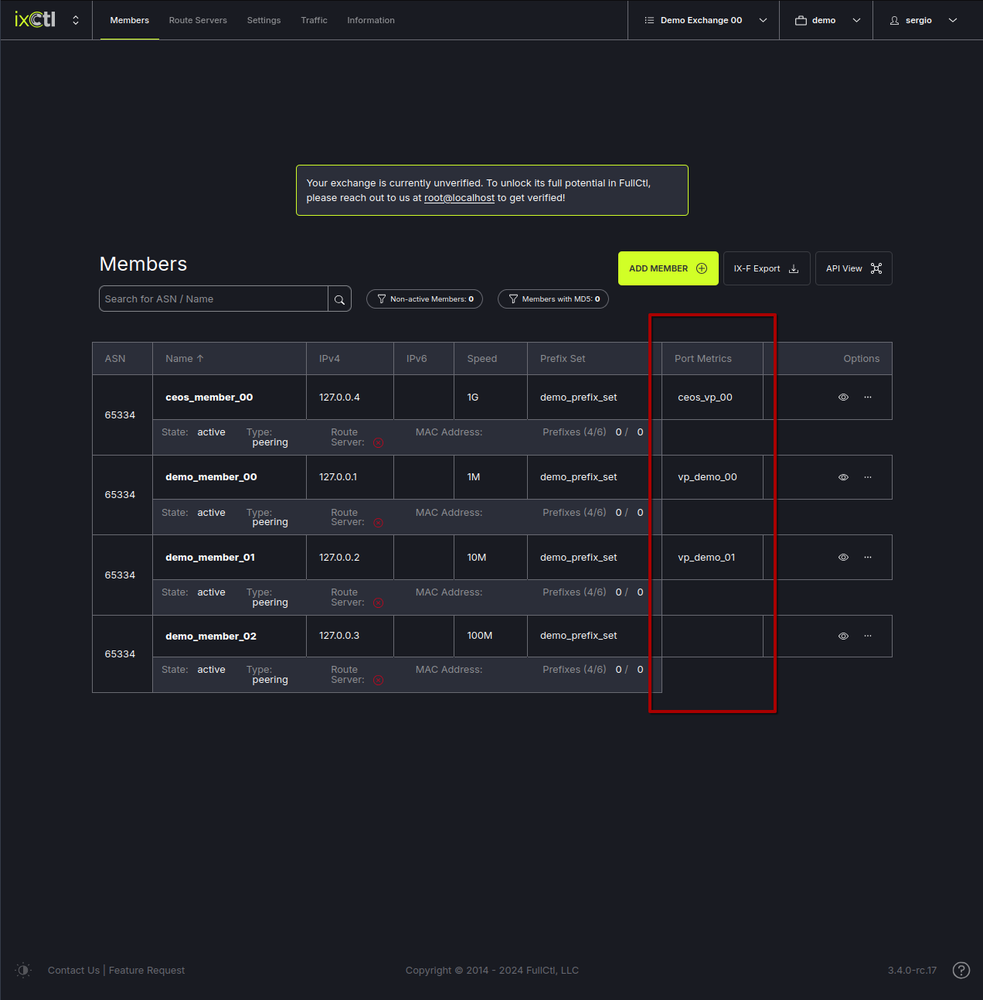
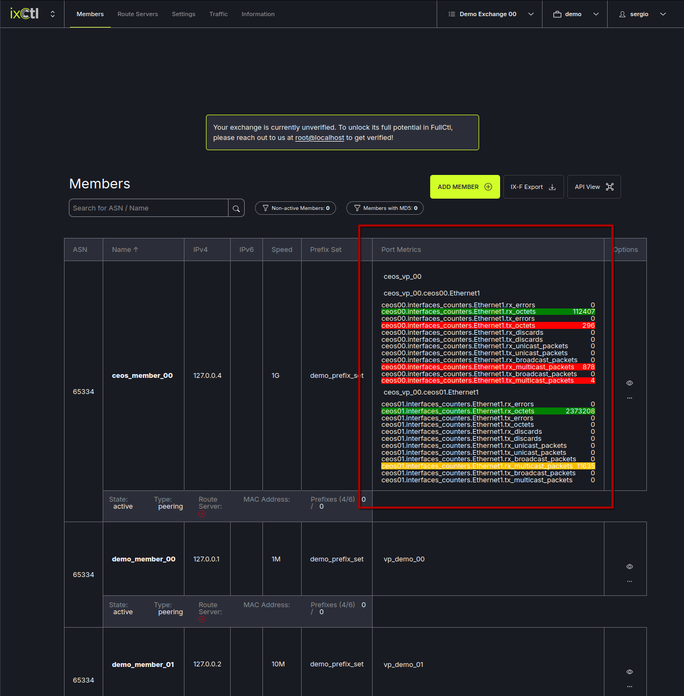
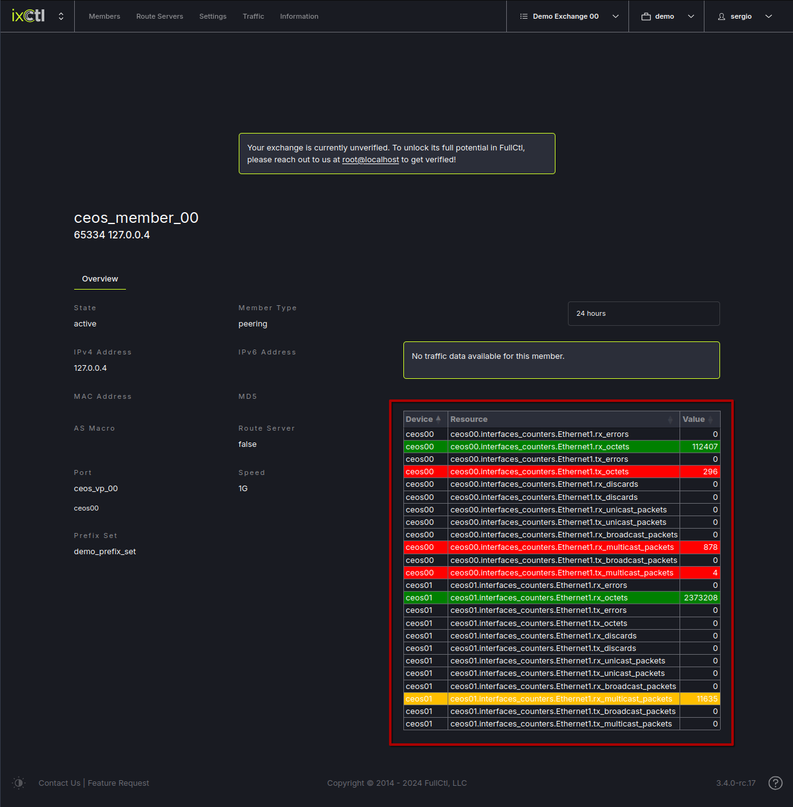

# Metrics

Visualize metrics.

[[_TOC_]]

## Members List

Member ports displayed in the members table.

Load metric data when clicking on the port name.

## Member Details

Show port metrics in member details view when click on the eye button.

