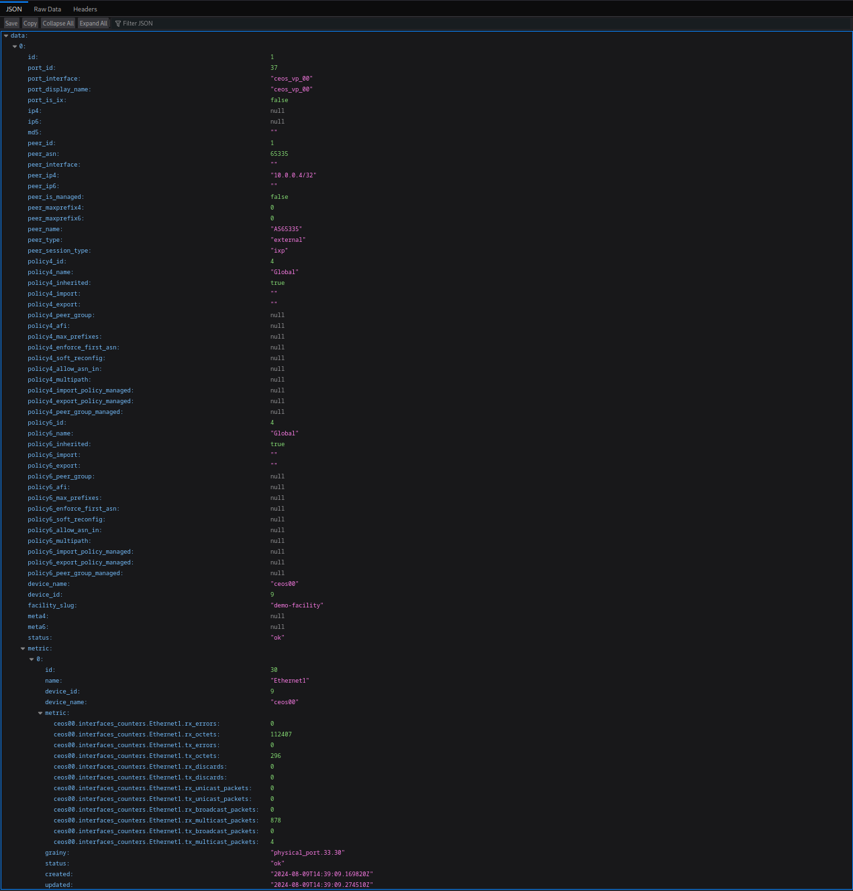

# Metrics

Visualize metrics.

[[_TOC_]]

## Peers Ports List

Peer ports displayed in the `summary` table.

Load metric data when clicking on the port name.

## Peer Port Details

Show port metrics in details view when click on the `view` button.

## Peer Port API View

JSON data when click on `API View` button.

